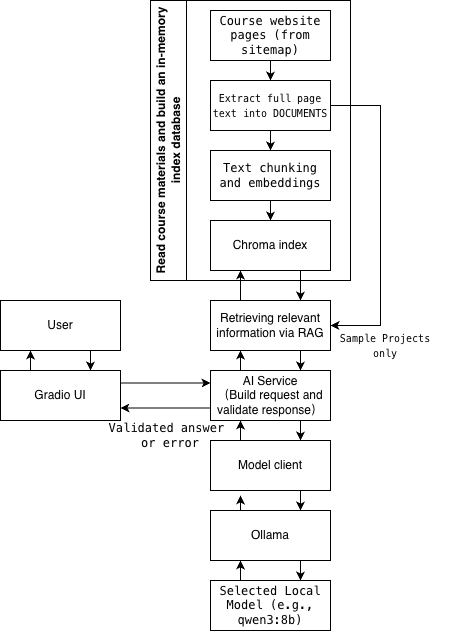

# AI Course Material Assistant

A RAG-based question-answering application that helps students find and understand information from the course website.

## Team members

- Qiaoqiao Zou (qiaoqiao.zou@student.hamk.fi)
- Xiaomeng Du (xiaomeng23000@student.hamk.fi)
- Neupane Nitish Raj (nitishraj.neupane@student.hamk.fi)
  
Group presentation video link: 
https://drive.google.com/file/d/1EsgYalRYRF6bzuqO1tF081fHJkJt5pxI/view?usp=sharing

## Problem

### Intended users
Students taking the Development of AI Applications course.

Course website:
https://mazarbaloch.github.io/dev-ai-course/

### Problem statement
The course information is distributed across multiple webpages and chapters. Students may need to search through several pages to find a specific requirement, deadline, definition, or explanation. This takes time and can lead to misunderstandings when relevant information appears on different pages.

### Why AI is appropriate
When a student asks a complex question, the system can integrate information from multiple sources, and the language model can then clearly explain the retrieved information. RAG (Retrieval-Augmented Generation) technology enables the application to answer questions using selected course materials rather than relying solely on the model's internal knowledge, resulting in more accurate answers. RAG gives the model course information to use when answering questions and answers can still be wrong, but students can also read the cited sources.

AI does not rely solely on hard-coded rules written by programmers; instead, it understands natural language and generates responses. While it is difficult for traditional programs to write rules covering every possible way of expression, language models can comprehend the underlying semantics.

## Solution

The application provides a Gradio interface where students can ask questions about a course.
The system retrieves relevant passages from selected course webpages. It sends the question and retrieved passages to a local model through Ollama, validates the model response.
The model is instructed to say when the supplied evidence is insufficient.
The service rejects replies that break the response or citation rules.

## Main user workflow

1. Select a model in the Gradio UI.
2. Enter a course question.
3. The AI service checks the input and gets course evidence through RAG.
4. The service combines instructions, the question, recent chat history,
   and numbered evidence.
5. The model client sends the request and response schema to the selected
   local model through Ollama.
6. The model generates a reply, which returns through Ollama
   and the model client to the AI service.
7. The service checks the response format and citations.
8. The UI displays the answer, runtime information, and cited sources.

## Architecture

The application uses a Gradio UI, an AI service, a RAG pipeline,
and a model client connected to Ollama.



See [Architecture Documentation](docs/architecture.md) for more details.

> **Core Architectural Rule:** The user interface must NEVER communicate directly with the model client or Ollama. All interactions must pass through the service layer (`ai_service.py`).

## Model

- **Model used:** We evaluated `qwen3:8b` and `qwen3.5:2b` to compare a larger model with a smaller one for local course question answering. In our three-case evaluation, qwen3:8b gave more complete answers.
qwen3.5:2b was faster but missed "limitations" in one project answer.
- **Selection rationale:**  
- **qwen3:8b:** The Ollama package is about 5.2 GB.
  Qwen3 supports text conversation, instruction following, and reasoning.
  We selected it to test whether it could give complete answers
  from the supplied course evidence.
- **qwen3.5:2b:** 
  It is a smaller model that supports text and image input.
  We selected it as a smaller local option and compared its answer
  quality and processing time with qwen3:8b.
  Our application uses text input only.

Both models can run locally through Ollama and receive requests
from our Python model client. No cloud model API key is needed.

## Additional AI capability

Select at least one additional capability to implement for your final project:

- [x] RAG (Retrieval-Augmented Generation)
- [ ] Tools / External API integration
- [ ] Model Context Protocol (MCP)
- [ ] Agentic workflow (Model-selected actions based on observations)
- [ ] Memory / Persistent state
- [ ] Multimodal interaction (Text + Images)
- [ ] Other: ______________________

### Capability justification
RAG is necessary because the application must answer questions using the current course materials rather than relying only on the model's internal knowledge. Without incorporating RAG, the answers provided might be overly broad or lack accuracy.

## Setup
Install Conda and Ollama first.
Run these commands from the project root.

Startup needs internet access to load the course webpages.
The embedding model may need a download on first use.
Keep Ollama running with at least one installed model.

The automated tests also need these startup conditions.

### 1. Create the Conda environment

```bash
conda env create -f environment.yml
```

### 2. Activate the environment

```bash
conda activate dev-ai-project
```

### 3. Configure environment variables

Copy `.env.example` to create your local `.env` configuration file:

On Linux / macOS:
```bash
cp .env.example .env
```

On Windows (Command Prompt / PowerShell):
```powershell
copy .env.example .env
```

Ensure `.env` contains valid values for `OLLAMA_BASE_URL` and `MODEL_NAME`:
```env
OLLAMA_BASE_URL=http://localhost:11434
MODEL_NAME=qwen3:8b
EMBEDDING_MODEL=sentence-transformers/all-MiniLM-L6-v2
```

### 4. Start Ollama

Make sure Ollama is installed and running locally, then pull your configured model:

```bash
ollama pull qwen3:8b
```

To repeat our two-model evaluation, also download:

```bash
ollama pull qwen3.5:2b
```
The UI initially selects the first installed model.
Select the model you want to use in the dropdown.

### 5. Run the application

Run the application from the root directory of the project:

```bash
python -m app.main
```

Then open your browser at `http://localhost:7860`.

### 6. Run automated tests

```bash
pytest
```

## Evaluation

The evaluation covers course-related question, out-of-scope questions, and empty or invalid input.

Test cases can be found in [`evaluation/test_cases.json`](evaluation/test_cases.json).

Refer to [`evaluation/README.md`](evaluation/README.md) for guidelines on defining success, edge cases, and failure scenarios.

Actual test results and known issues are recorded in
[evaluation/evaluation_results.md](evaluation/evaluation_results.md).

All 8 automated tests passed.

We tested 3 questions with 2 models.
Five of the 6 answers passed manual review.
One answer missed a required item.

## Known limitations

- The loader is designed for this course website, not any website.
- Only public course HTML documentation is loaded.
- The application will not access course content requiring authentication.
- The exercise and sample-project rules match specific English wording.
- The app may miss details even when the correct evidence is supplied.
- Answers and response categories can be wrong.
- The loader does not read linked PDFs, images, videos,
  notebooks, or external repositories.
- The document index stays in memory and is rebuilt at startup.
- Answer quality will depend on retrieval quality and the selected local model.
- The evaluation covers a small number of questions.

## Future improvements

- Support loading more complex web pages.
- Support PDF slides and other document formats.
- Improve retrieval and citation selection.